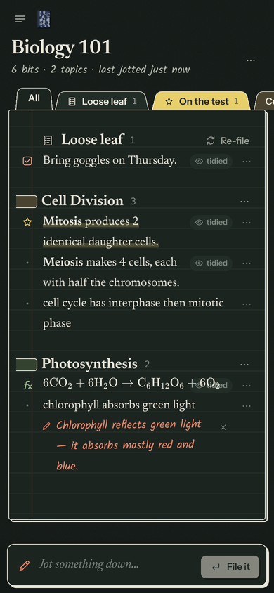

# xleaf

**Spill it in class. Find it filed later.**

A notebook you can throw half-sentences at. Type whatever your teacher just said, one bit at a time, and xleaf files each bit under the right topic, tidies the wording, typesets the math, and highlights anything that'll be on the test.




- **Jot, don't organise.** One line at a time from the box at the bottom. `#topic` routes a bit yourself; `!!` or "on the test" highlights it.
- **Files itself.** An on-device sorter matches words against your topics and learns from what you've filed. Turn on smart filing and Claude does it properly.
- **Tidies as it goes.** Claude Haiku fixes typos, expands shorthand and writes math in LaTeX ($F = ma$ → rendered with KaTeX). What you actually typed is always kept: tap **tidied** to see it.
- **Checks its own work.** Every so often Claude Sonnet reads back over new bits. It re-files strays, fixes rewrites that drifted from what you meant, suggests merging duplicate topics, and pencils a red margin note if a fact looks wrong.
- **Binder tabs.** Each topic is a coloured divider. There's also **Loose leaf** for bits that don't fit yet (with "looks like a topic" suggestions) and **On the test** for every exam hint across the notebook.
- **Works offline, syncs when it can.** Changes queue on the device and drain to Supabase when the Wi-Fi comes back. Install it to your phone's home screen.
- **Paper and Chalkboard** themes, search everything with <kbd>⌘K</kbd>, drag bits onto tabs, and export a notebook as Markdown (math included) or everything as JSON.

<br clear="right">

## Costs: $0

| Piece | Service | Free tier |
| --- | --- | --- |
| Website | GitHub Pages | Free for public repos |
| Accounts + sync | Supabase | 500 MB database, 50k monthly users; pauses after 7 days of no activity (one click to wake) |
| AI filing + review | Claude via [Puter.js](https://docs.puter.com) | "User pays": each person signs in with their own Puter account and usage comes out of its **free monthly allowance** |
| Without AI | on-device sorter | Free, works offline |

Sync and AI are both optional. With neither, xleaf runs fully in the browser and saves to `localStorage`.

---

## Run it locally

```bash
npm install
npm run dev        # http://localhost:5173
npm test           # sorter + rendering tests
npm run build      # typecheck + production build into dist/
```

With no `.env.local` it runs in "this device only" mode. That's enough to try everything except sync.

## Set it up for real (~15 minutes)

### 1. Supabase (accounts + sync)

1. Create a free project at [supabase.com](https://supabase.com). Any region near you, and save the database password somewhere.
2. **SQL Editor → New query**: paste all of [`supabase/migrations/20261019000000_init.sql`](supabase/migrations/20261019000000_init.sql) and press **Run**. This creates the `notebooks`, `topics` and `notes` tables with row-level security, so each account only ever sees its own rows.
3. **Authentication → Sign In / Providers → Email**: leave it enabled. For a personal app you can switch **Confirm email** off, so sign-up logs you straight in.
4. **Authentication → URL Configuration**:
   - **Site URL**: `https://<your-github-username>.github.io/xnotebook/`
   - **Redirect URLs**: add that same URL and `http://localhost:5173/` (password-reset and confirmation links land here).
5. **Project Settings → API Keys**: copy the **Project URL** and the **anon / publishable** key. Both are safe to put in a public website; row-level security is what protects the data. Never use the `service_role` / secret key in the app.
6. For local dev, create `.env.local`:
   ```
   VITE_SUPABASE_URL=https://xxxx.supabase.co
   VITE_SUPABASE_ANON_KEY=eyJ... (or sb_publishable_...)
   ```
7. Open the app, **Make an account**, and sign in.
8. Since it's just you: **Authentication → Sign In / Providers → turn off "Allow new users to sign up"** so nobody else can create accounts on your project.

### 2. GitHub Pages (hosting)

1. The repo needs to be **public** for free GitHub Pages. Nothing secret lives in it.
2. **Settings → Pages → Build and deployment → Source: GitHub Actions**.
3. **Settings → Secrets and variables → Actions → Variables tab** → add `VITE_SUPABASE_URL` and `VITE_SUPABASE_ANON_KEY` (same values as above).
4. Merge to `main` (or run the **Deploy to GitHub Pages** workflow by hand). [`.github/workflows/deploy.yml`](.github/workflows/deploy.yml) tests, builds and publishes to `https://<you>.github.io/xnotebook/`.

### 3. Smart filing (Claude via Puter)

Nothing to configure. In the app: **Settings → Smart filing → Connect Puter**, then sign in or sign up in the popup. After that:

- **Live filing** uses the newest Claude Haiku Puter offers. It files, tags and tidies each bit about a second after you jot it, batching quick bursts into one request.
- **Review pass** uses the newest Claude Sonnet. It runs after ~8 quiet minutes (class is over) or once a dozen new bits pile up, and whenever you hit **Review**.
- Both models can be pinned to specific versions in Settings. Turning off **Tidy wording & typeset math** keeps your exact words.

Puter's free allowance is **monthly**, not daily. Filing a bit is a few hundred tokens, so a normal school week of notes is a small slice of it.

### 4. Put it on your phone

Open the site in Safari (iOS) or Chrome (Android) → **Share → Add to Home Screen**. It opens full-screen like an app, and <kbd>/</kbd> or <kbd>n</kbd> jumps to the jot box on a keyboard.

---

## How it fits together

```
 browser (React + Vite, static on GitHub Pages)
 ├─ store.ts      every change is an "op": applied to memory → saved to localStorage
 │                → queued in an outbox → drained to Supabase (retries when offline)
 ├─ sorter/       on-device: hashtag routing, kind detection (exam/todo/definition…),
 │                TF-IDF topic matching, "looks like a topic" suggestions
 ├─ ai.ts         Puter.js → Claude Haiku (file + tidy) and Claude Sonnet (review),
 │                strict JSON-schema output
 └─ render.ts     escaped text + **bold**/*italic*/`code` + KaTeX (lazy-loaded)

 Supabase: auth (email + password) + Postgres with row-level security
```

```
src/
  App.tsx                 routes, theme, keyboard shortcuts
  components/
    NotebookView.tsx      header, binder tabs, sections, merge suggestions
    NoteRow.tsx           one bit: kind glyph, text, red-pen flag, menus, inline edit
    CaptureBar.tsx        the jot box + "just jotted" strip
    Shelf.tsx             sidebar of notebooks (marbled composition-book covers)
    Settings.tsx, SearchPalette.tsx, AuthScreen.tsx, Welcome.tsx
    Art.tsx, Icon.tsx     all illustrations and icons, inline SVG
  lib/
    store.ts  ai.ts  render.ts  sorter/  route.ts  exporter.ts
  styles/app.css          Paper + Chalkboard themes
supabase/migrations/      the database schema
docs/PLAN.md              product plan and roadmap
```

To rename the app, change `APP_NAME` in `src/lib/brand.ts` plus the `<title>` in `index.html` and `public/manifest.webmanifest`.
